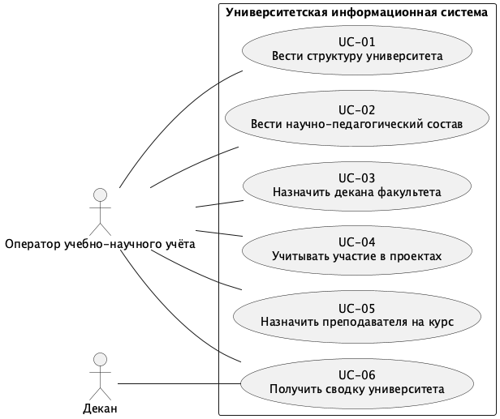
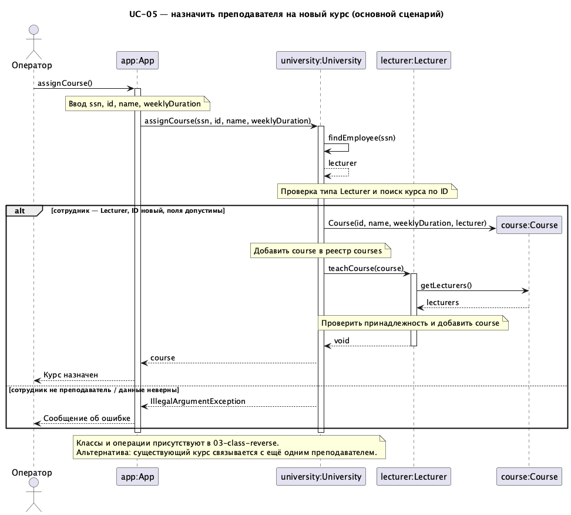
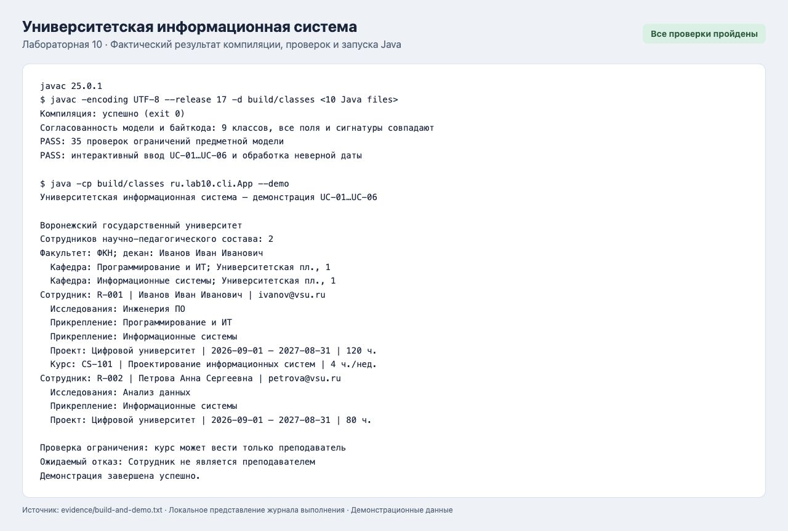

# Лабораторная работа 10 · UML-моделирование

**Университетская информационная система** — консольный Java-проект учёта научно-педагогического состава. В комплекте редактируемая модель, исходники, UML-диаграммы, результат обратного инжиниринга и снимок выполнения. Проект подготовлен локально, публикация в GitHub не выполнялась.

## Запуск

Нужны **JDK 17+** (`java`, `javac`, `javap` в PATH) и **Python 3.9+**. Maven, сторонние Java-библиотеки и установка Python-пакетов не требуются.

Из каталога проекта:

```sh
python3 tools/build.py --verify
java -cp build/classes ru.lab10.cli.App --demo
java -cp build/classes ru.lab10.cli.App
```

Первой командой заново генерируются предметные классы, компилируется приложение, строится обратная модель, выполняются проверки и демонстрация. Последняя команда запускает интерактивное меню с вводом с клавиатуры. При обычном запуске реестр пуст: создайте факультет и кафедру, зарегистрируйте сотрудника, назначьте декана, затем ведите проекты и курсы. Ввод дат — `YYYY-MM-DD`, часов — положительное целое число. Данные хранятся в памяти до завершения программы; сохранение в БД не входит в этот прототип.

Воспроизводимый пример ввода:

```sh
java -cp build/classes ru.lab10.cli.App < examples/interactive-input.txt
```

Windows: используйте `py -3 tools/build.py --verify`, если команда `python3` недоступна; перенаправление ввода выполняйте в `cmd.exe`.

## Состав проекта

| Путь | Назначение |
|---|---|
| `model/university.json` | Редактируемая модель: классы, атрибуты, операции с реализациями, отношения |
| `src/main/java/ru/lab10/domain/` | Девять Java-классов, сгенерированных из модели |
| `src/main/java/ru/lab10/cli/App.java` | Добавленный вручную консольный ввод/вывод |
| `diagrams/*.puml` | Редактируемые UML-диаграммы PlantUML |
| `diagrams/*.svg`, `diagrams/*.png` | Готовые изображения тех же диаграмм |
| `tools/generate.py` | Прямое преобразование модели в Java и диаграмму классов |
| `tools/reverse.py` | Обратный инжиниринг скомпилированных классов через `javap` |
| `tools/build.py` | Компиляция, проверка согласованности и запуск |
| `src/test/java/ru/lab10/DomainTest.java` | Проверки предметных ограничений и неизменности данных при отказе |
| `evidence/` | Фактический вывод компиляции/выполнения, API байткода и скриншот |

Используется разрешённая заданием альтернатива Visual Paradigm: PlantUML для UML-представлений и скрипты прямого/обратного преобразования. **Файла Visual Paradigm `.vpp` в проекте нет.** Модель JSON содержит тела операций: генератор переносит их в Java; это генерация из явно заданной модели, а не автоматическое получение бизнес-логики из картинки. Для изменений предметных классов редактируйте модель и повторяйте сборку: ручные правки сгенерированного Java будут перезаписаны.

## Текстовый анализ: шаги 1–4

| Фрагмент задания | Класс / атрибут / связь |
|---|---|
| Университет состоит из факультетов, факультеты разделены на кафедры | `University`, `Faculty`, `Institute`; две композиции |
| Факультет и кафедра имеют название; для кафедры известен адрес | `Faculty.name`, `Institute.name`, `Institute.address` |
| Декан является сотрудником университета | Роль `Faculty.dean: Employee`, ассоциация; отдельный класс Dean не нужен |
| Общее число сотрудников известно | Вычисляемое `University.getNumberOfEmployees()` |
| Социальный код, имя и e-mail сотрудника | Абстрактный `Employee`: `socialSecurityNumber`, `name`, `email` |
| Научный сотрудник и область исследований | `ResearchEmployee extends Employee`, `researchArea` |
| Каждый научный сотрудник прикреплён минимум к одной кафедре | Ассоциация `ResearchEmployee → Institute`, `1..*` кафедр |
| Сотрудник участвует в проектах определённое число часов | `Project` и класс связи `Participation`, `hours` относится к паре сотрудник–проект |
| Название проекта, начало и окончание | `Project.name`, `startingDate`, `endDate` |
| Некоторые научные сотрудники ведут курсы и называются преподавателями | `Lecturer extends ResearchEmployee` |
| Уникальный номер курса, название и недельная длительность | `Course.id`, `name`, `weeklyDuration` |

Научный и административный персонал различаются в исходном описании. По уточнению преподавателя в этой работе реализован **только научно-педагогический состав**; административный персонал, студенты и запись студентов на курсы не моделируются. Абстрактный `Employee` оставлен как общий тип сотрудника и тип роли декана.

Операции определены по целям пользователей: создание факультетов/кафедр, регистрация научного сотрудника, прикрепление к кафедрам, назначение декана, создание проекта и назначение часов участия, назначение преподавателя на курс, получение сводки. Полный список атрибутов и операций представлен в диаграммах классов.

### Отношения и ограничения

- Композиции `University–Faculty` и `Faculty–Institute`: подразделение создаётся своим владельцем и не переносится к другому владельцу.
- Агрегации `University–ResearchEmployee`, `University–Project`, `University–Course`: университет ведёт реестры самостоятельных сущностей. Операции удаления в прототипе отсутствуют.
- Обобщения `Employee ← ResearchEmployee ← Lecturer` реализованы наследованием Java.
- Один исследователь имеет одну или несколько кафедр этого университета; прикрепление создаётся одновременно с сотрудником. Удаление последней кафедры через API невозможно.
- `Participation` принадлежит сотруднику и ссылается на один проект. Пара сотрудник–проект уникальна, часы участия положительны и могут различаться у сотрудников одного проекта.
- Курс имеет уникальный ID в университете. Один курс могут вести несколько преподавателей; один преподаватель — несколько курсов. Повторное назначение той же пары отклоняется. Существующий ID можно указать для второго преподавателя при совпадении названия и часов.
- Социальный код уникален в реестре университета. Названия факультетов, кафедр внутри факультета и проектов в этом прототипе также уникальны (дополнительное соглашение для удобного консольного поиска).
- Даты проекта обязательны: начало не позже окончания. Длительность курса и часы участия представлены целыми положительными числами.
- У факультета в готовой конфигурации ровно один декан из сотрудников университета; один сотрудник занимает эту роль не более чем в одном факультете, как в приложении к заданию.
- Создание структуры выполняется поэтапно. В черновике допустимы пустой университет, факультет без кафедр или ещё не назначенный декан. `validateReady()` перед сводкой требует минимум один факультет, минимум одну кафедру на факультет и назначенного декана. Это объясняет нижние границы `0` в технической модели; для готовой структуры действуют указанные ограничения.

Коллекции возвращаются только для чтения; создание связей проходит через операции предметных классов. Пользовательские роли описывают рабочие обязанности: авторизация и разграничение доступа в данном учебном прототипе не реализуются.

## Прецеденты и согласованность UML

Акторы находятся **за границей единственной системы**. Декан как актор — роль пользователя, `Faculty.dean` — хранимая ссылка на сотрудника. Эти понятия не смешиваются. В диаграмме прецедентов нет алгоритмических шагов, проверок полей, циклов или порядка выполнения.

| Прецедент | Актор | Команда меню и реализация |
|---|---|---|
| UC-01 Вести структуру университета | Оператор | `1`: `App.manageStructure()`, `University.addFaculty()`, `Faculty.addInstitute()` |
| UC-02 Вести научно-педагогический состав | Оператор | `2`: `App.manageEmployee()`, `University.registerEmployee()`, `ResearchEmployee.attachTo()` |
| UC-03 Назначить декана факультета | Оператор | `3`: `App.appointDean()`, `Faculty.appointDean()` |
| UC-04 Учитывать участие в проектах | Оператор | `4`: `App.assignProject()`, `University.createProject()`, `assignToProject()`, `ResearchEmployee.joinProject()` |
| UC-05 Назначить преподавателя на курс | Оператор | `5`: `App.assignCourse()`, `University.assignCourse()`, `Course.addLecturer()`, `Lecturer.teachCourse()` |
| UC-06 Получить сводку университета | Оператор, декан | `6`: `App.printSummary()`, `University.validateReady()`, методы чтения |

### Спецификация UC-05

**Цель:** закрепить преподавателя за курсом. **Актор:** оператор учебно-научного учёта. **Триггер:** оператор выбирает пункт 5. **Предусловие:** в университете зарегистрирован преподаватель. **Вход:** социальный код, ID, название и часы курса.

**Основной сценарий:** оператор вводит параметры → система находит сотрудника и проверяет роль преподавателя → проверяет, что ID курса новый → создаёт курс с первым преподавателем → добавляет курс в реестр и в список преподавателя → подтверждает назначение. **Постусловие:** обе стороны связи согласованы, ID курса уникален.

**Альтернативы:** существующий курс связывается с ещё одним преподавателем, если название и часы совпадают; неизвестный сотрудник, неподходящая роль, повторное назначение, конфликт ID или недопустимые поля приводят к сообщению об ошибке без изменения назначения. Ошибка преобразования числа обрабатывается на границе ввода.

Обе поведенческие диаграммы относятся к **UC-05**. На диаграмме последовательностей показан основной сценарий нового курса и ветвь ошибки. Все её объектные линии жизни — экземпляры `App`, `University`, `Lecturer`, `Course`; все сообщения-вызовы соответствуют существующим операциям этих классов (в том числе наследуемым). Диаграмма активностей дополнительно показывает назначение второго преподавателя на существующий курс.

## Диаграммы

1. [Прецеденты](diagrams/01-use-cases.svg) · [исходник](diagrams/01-use-cases.puml)
2. [Модель классов до обратного преобразования](diagrams/02-class-model.svg) · [исходник](diagrams/02-class-model.puml)
3. [Классы после обратного инжиниринга](diagrams/03-class-reverse.svg) · [исходник](diagrams/03-class-reverse.puml)
4. [Последовательность UC-05](diagrams/04-sequence-course.svg) · [исходник](diagrams/04-sequence-course.puml)
5. [Активности UC-05](diagrams/05-activity-course.svg) · [исходник](diagrams/05-activity-course.puml)





Для крупных диаграмм классов открывайте SVG с масштабированием. На прямой диаграмме `App` показан как добавленный класс границы с основными операциями. На обратной диаграмме представлены **все 10 классов приложения**, их объявленные поля, конструкторы, операции, модификаторы доступа и наследование; унаследованные методы остаются в суперклассе. Технические синтетические методы лямбд не являются операциями предметной модели и исключены.

Обратный генератор читает **скомпилированные `.class` через `javap`**, а не исходную JSON-модель. Ассоциации строятся из фактических типов полей. Кратности и композиция не восстанавливаются из Java автоматически, поэтому их семантика показана на прямой диаграмме и описана выше. Сырой вывод находится в [javap.txt](evidence/javap.txt), машинный API — в [reverse-api.json](evidence/reverse-api.json). Сборка сравнивает все поля и сигнатуры девяти предметных классов с моделью и завершается ошибкой при расхождении.

Для повторного экспорта нужен [PlantUML](https://plantuml.com/download), использована версия 1.2025.2. Внешний Graphviz не нужен: диаграммы используют встроенный Smetana.

```sh
java -Djava.awt.headless=true -jar /path/to/plantuml.jar -tsvg diagrams
java -Djava.awt.headless=true -jar /path/to/plantuml.jar -tpng diagrams
```

## Проверка выполнения

Выполнена компиляция `javac 25.0.1` с целевой версией Java 17. Пройдены 35 проверок: обязательные кафедры, уникальность кодов/ID, деканы, принадлежность университету, даты проектов, положительные часы, часы отдельно для каждого участника, многопреподавательский курс, защита коллекций и отсутствие частичного назначения курса при отказе. Отдельно проверены интерактивный сценарий всех шести прецедентов и неверная дата.

- [Полный фактический вывод сборки и демонстрации](evidence/build-and-demo.txt)
- [Вывод интерактивного сценария](evidence/interactive-output.txt)
- [Скриншот результата](evidence/execution.jpg)



Скриншот снят с локальной страницы, показывающей сохранённый фактический stdout `javac`/`java` и проверок. Это представление результата запуска в браузере; исходный журнал доступен рядом, изображение терминала не имитируется. Все данные демонстрации синтетические.

## Методические источники

- Исходное задание `lab10.pdf`, предоставленное пользователем.
- [Use Case Diagram — UML@Classroom, слайды 2015](https://www.uml.ac.at/wp-content/uploads/2012/05/01_UseCaseDiagram_slides_2015.pptx): изучены границы системы, акторы, цели прецедентов и ошибки функциональной декомпозиции.
- [Visual Paradigm: How to Use Textual Analysis](https://www.visual-paradigm.com/tutorials/how-to-use-textual-analysis.jsp): использован подход выделения кандидатов в классы, акторы и прецеденты из описания.
- [Как создавать эффективные Use Case](https://edu.vsu.ru/mod/resource/view.php?id=1064198) и [OTV на русском](https://edu.vsu.ru/mod/resource/view.php?id=1063562): страницы учебного портала недоступны в текущем окружении; их содержимое не использовалось. OTV является методическим примером, предметная область проекта взята из предоставленного PDF.

Отдельный текстовый/PDF-отчёт не создаётся в соответствии с обновлённым требованием. README содержит сведения для проверки и запуска проекта.
